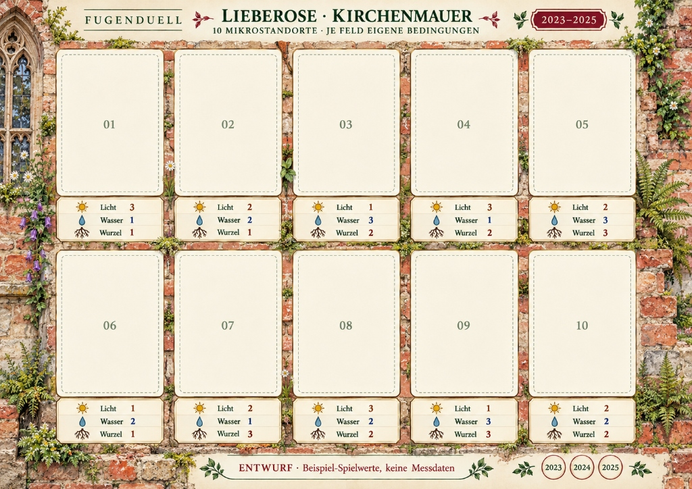

# Die Arena: Kirchenmauer Lieberose

## 1. Was ist dieser Ort?
Die **Stadtkirche Lieberose** (Brandenburg) ist eine historische gotische Backsteinkirche, die Ende des Zweiten Weltkriegs (April 1945, Kesselschlacht von Halbe) schwer beschädigt und zur Ruine wurde. 

Für Stadtökologen und Kinder ist diese Mauer ein lebendes Labor:
* Uralte, handgestrichene Backsteine wechseln sich mit kalkhaltigem Fugenmörtel ab.
* Vertikale Ritzen trotzen Wind, Sonne und Eis.
* Die Mauer besitzt einen extremen **Höhengradienten (Z-Achse)**: Oben kocht die Sonne, unten im Sockel sammelt sich kühles Sickerwasser.

---

## 2. Der vertikale Gradient (Oben vs. Unten)

In der Natur verändern sich die Lebensbedingungen alle 50 Zentimeter:

### Die Obere Reihe (Slots 01 bis 05): Mauerkrone & Sims
* **Licht:** Überwiegend `Licht 3` (Volle Sonne, keine Beschattung).
* **Wasser:** Überwiegend `Wasser 1` (Regen läuft an den senkrechten Ziegeln sofort ab; der Wind trocknet die Fugen in zwei Stunden aus).
* **Störungen:** Starkwind, Blitzeinschlag-Gefahr, Vogelkot (Tauben, Dohlen, Fledermäuse).
* **Typische Bewohner:** Sukkulenten (*Portulak*), hitzeresistente Moose (*Silbermoos*), zähe Mauerfarne (*Mauerraute*).

### Die Untere Reihe (Slots 06 bis 10): Sockel & Spritzwasserzone
* **Licht:** Überwiegend `Licht 1 bis 2` (Schlagschatten der Kirchenmauer und umstehender Bäume).
* **Wasser:** Überwiegend `Wasser 2 bis 3` (Sickerwasser fließt nach unten, Pfützenfeuchte, Bodenkontakt).
* **Störungen:** Gehweg-Trittdruck an Kante 10, Hunde-Urin, Laub-Akkumulation im Herbst.
* **Typische Bewohner:** Feuchtigkeitsliebende Gräser (*Rispengras*), hochwüchsige Stauden (*Schöllkraut*), dichte Moosteppiche.

---

## 3. Die 10 Mikro-Nischen im Porträt

1. **Slot 01 — Mauerkrone (Süd):** Die exponierteste Kante der Ruine. Maximales Sonnenlicht, minimales Wasser. Hier überleben nur echte Wüsten-Pioniere.
2. **Slot 02 — Wasserspeier-Spur:** Eine alte Kupferdachrinne hat ein Leck. Bei jedem Regenfall stürzt hier ein kleiner Wasserfall herab. Im Sommer bleibt die Fuge durch sickernde Feuchtigkeit grün.
3. **Slot 03 — Gotische Fensternische:** Das tiefe Maßwerk des gotischen Fensters spendet dauerhaften Halbschatten. Windgeschützt und temperaturgepuffert.
4. **Slot 04 — Kragstein (Taubensitz):** Auf dem Steinquader rasten verwilderte Stadttauben. Der Boden dieser Fuge ist voll von weißem Vogelkot (Guano): Extrem hoher Stickstoffwert ($N+2$). Schwache Keimlinge verbrennen an der Säure, aber Nährstoffmonster wie Schöllkraut wachsen gigantisch.
5. **Slot 05 — Mürber Ziegelspalt:** Ein alter Backstein ist durch Frostabplatzung aufgeweicht. Wurzeln können sich tief in den zerfallenen Lehm bohren (`Wurzel 3`).
6. **Slot 06 — Kalkmörtel-Spalt:** Hier wurde vor Jahrhunderten Muschelkalk verbaut. Der Fugenmörtel ist stark basisch ($pH > 7{,}8$). Giftig für säureliebende Pflanzen, aber das absolute Paradies für die Mauerraute.
7. **Slot 07 — Normale Mauerfuge:** Ein eng sitzender, glatter Fugenstrich mit wenig Fugenbreite. Platz für genau 1 Trieb.
8. **Slot 08 — Mäusegang / Höhle:** Zwischen zwei Ziegeln fehlt Mörtel. Ein dunkler, tiefer Hohlraum führt ins Innere des Mauerwerks. Hier herrscht ganzjährig die gleiche kühle Temperatur (`Bunker-Effekt`).
9. **Slot 09 — Nord-Ecke (Dauermoos):** Hierhin gelangt fast nie direktes Sonnenlicht. Das Silbermoos und Mauer-Drehzahnmoos haben über Jahrzehnte einen dauerhaften Moosteppich gebildet.
10. **Slot 10 — Sockelkante (Pflaster-Übergang):** Der Übergang von der Mauer zum Kopfsteinpflaster. Hier treten Menschen vorbei, hier rollen Kehrmaschinen oder Fahrräder. Hoher Trittdruck, aber guter Erdkontakt.

---

## 4. Die 4 Epochen-Jahre (Geschichte als Arena-Wetter)

Jedes Spiel kann in einem anderen dramatischen historischen Jahr von Lieberose stattfinden:

### Epoche 1945 — „Der Trümmer-Frühling“
* **Hintergrund:** Die Kirche wird im April 1945 durch Artilleriegranaten getroffen.
* **Besonderheit:** Auf den Slots 05 und 08 entstehen neue Trümmerklüfte (`Wurzel 3`). Asche und Kalkstaub wehen über die Wand. Wer tief wurzeln kann, gewinnt Raum.

### Epoche 1947 — „Der Jahrhundertwinter“
* **Hintergrund:** Einer der kältesten Winter Europas mit monatelangem Kahlfrost unter $-20\,^\circ\text{C}$.
* **Besonderheit:** Im Winter sterben alle zarten Lvl-1-Wurzeln ab. Nur wer verholzt ist (Lvl 2) oder sich in das Moosbett zurückzieht, überlebt. Im Frühling folgt eine enorme Schmelzwasser-Flut.

### Epoche 2018 — „Der Große Heidebrand-Sommer“
* **Hintergrund:** Fünf Monate lang fällt kein Tropfen Regen in Südbrandenburg. Die Ziegel heizen sich tagsüber auf $60\,^\circ\text{C}$ auf.
* **Besonderheit:** Alle normalen Wasserwerte sinken auf `Wasser 0`. Nur Slot 02 (Wasserspeier) und Slot 09 (Moosbett) behalten Feuchtigkeit. Ein brutaler Kampf um diese beiden Oasen!

### Epoche 2024 — „Die Baugerüst-Sanierung“
* **Hintergrund:** Die Kirchengemeinde und Denkmalschützer bauen Gerüste auf, um die Mauerkrone zu sichern.
* **Besonderheit:** Bauplanken werfen Schatten auf Slot 01 und 04 (`Licht -1`). Arbeiter zupfen tiefwurzelnde Birken und Sträucher aus den oberen Fugen. Flache Pflanzen unter 5 cm bleiben unbemerkt.
