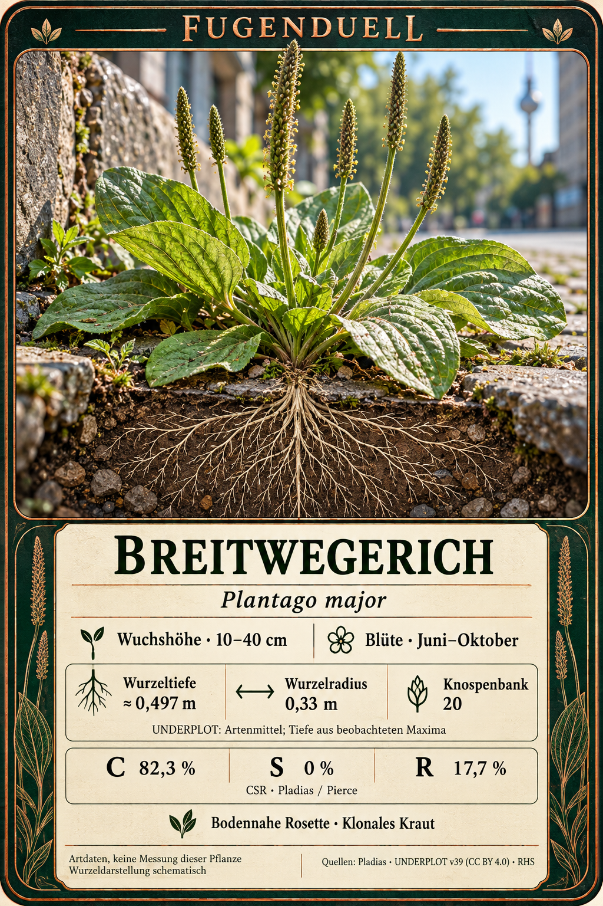
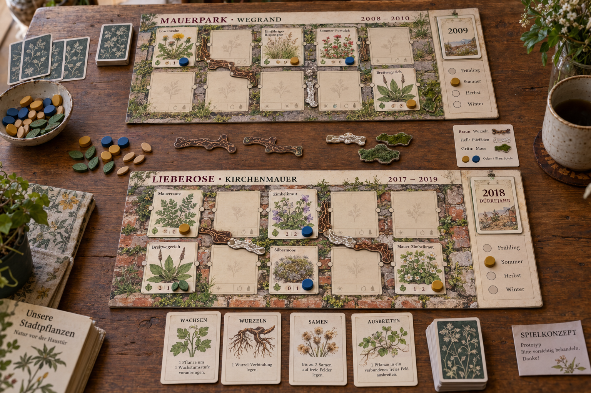
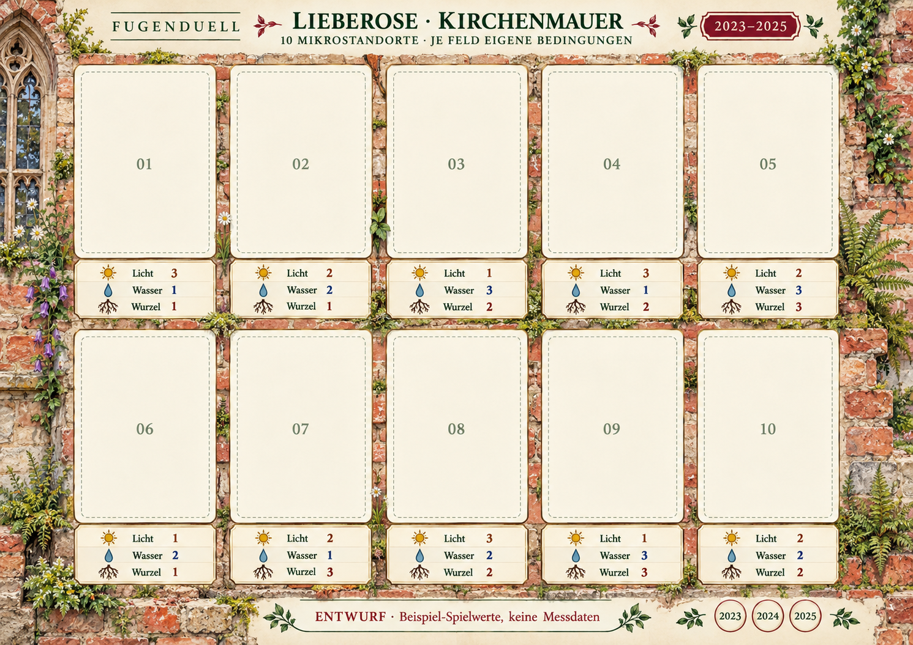

# Fugenduel — Bilder und Druckentwürfe

Stand: 30.10.2026. Alle Dateien bleiben in ihrer ursprünglichen Bildqualität erhalten. Die Grafiken sind Entwürfe; gedruckte Zahlen können von den inzwischen überarbeiteten Tabellen abweichen. Details im [Statusreview](../07-status-review.md).

## Importierte Bilder

| Vorschau | Inhalt und Status |
|---|---|
|  | **Breitwegerich-Datenkarte**, 1024 × 1536. Importiert. Wurzeltiefe, Radius, Knospenbank und CSR anhand der Quellen bestätigt; Artwerte, keine Messung dieser abgebildeten Pflanze. |
|  | **Mauerpark und Lieberose**, 1536 × 1024. Importiert. Illustratives Konzept mit zwei Arenen, Aktionskarten und Verbindungen. Keine Dokumentation eines tatsächlichen Spieltests. |
|  | **Lieberose-Brett 2023–2025**, 1491 × 1055. Größeres PNG-Original importiert; entspricht dem Motiv des bereits vorhandenen [JPEG](lieberose-kirchenmauer.jpg). Sieben Slotwerte weichen von der Texttabelle ab. |

## Bereits vorhandene Entwürfe

| Datei | Inhalt und Status |
|---|---|
| [Arenaporträt 10:51:06](ChatGPT-Bild%2030.%20Okt.%202026,%2010_51_06.png) | Lieberose 2023–2025, 1054 × 1492. Leere Wetter- und Standortfelder; keine gemessenen Klimadaten eingetragen. Bytegleich mit einer Quelldatei. |
| [Brett mit Jahreskarte](ChatGPT-Bild%2030.%20Okt.%202026,%2010_51_59.png) | Lieberose 2017–2019 mit 2018-Dürrekarte, 1491 × 1055. Eigenständige Standortzuordnung; bytegleich mit einer Quelldatei. |
| [Arenaporträt 10:52:11](ChatGPT-Bild%2030.%20Okt.%202026,%2010_52_11.png) | Exaktes Duplikat des Arenaporträts 10:51:06; gleicher SHA-256. Zur Erhaltung der vorhandenen Dateien nicht gelöscht. |
| [Ursprüngliches Brett-JPEG](lieberose-kirchenmauer.jpg) | 1024 × 724; komprimierte kleinere Fassung des Brettmotivs. |
| [Zimbelkraut Level 1](Zimbelkraut.jpg) | Vom Nutzer lokal ergänzte Karte, 1696 × 2528. Spielwerte 2/2/1/1 stimmen mit dem gemeinsamen Datensatz überein. Keine Zuordnung zu den beiden angegebenen Quellordnern belegt. |
| [Verbindungen und Moos A4 v1](Fugenduell-Verbindungen-A4-v1.pdf) | Zwei A4-Seiten für Vorder-/Rückseite. Enthält Wurzelzugang, Kriechtrasse, Pilzverbindung, Ameisenroute und Moos. Separater Regelentwurf mit Energie- und Nährstoff-Token. |

## Herkunft

Geprüft wurden ausschließlich die beiden angegebenen Ordner unter `C:\Users\Admin\.codex\generated_images`: `01a130f6-b1f8-7313-bcaf-766769483759` und `01a187a7-98bd-7922-b964-6687926123ea`. Die Zuordnung aller fünf PNGs, Größen und Prüfsummen steht in [import-2026-10-30.json](import-2026-10-30.json). Drei Dateien fehlten; zwei waren bereits vorhanden. Eine Vollständigkeitsprüfung privater ChatGPT-Gespräche war nicht möglich.
