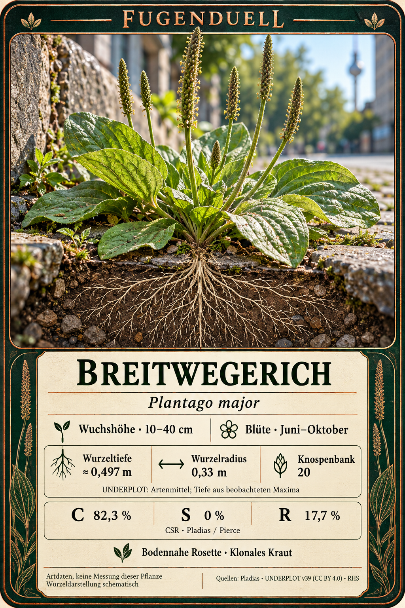
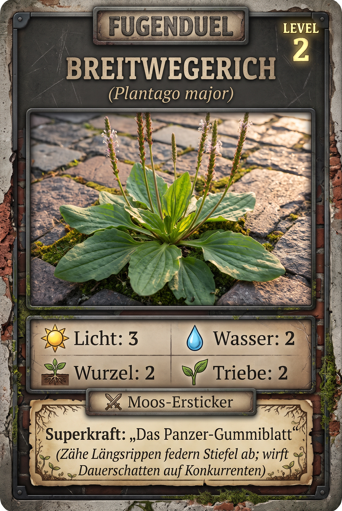

# Breitwegerich (*Plantago major*)

> **Familie:** Plantaginaceae (Wegerichgewächse)  
> **Lebensform:** Hemicryptophyt (Knospen an der Erdoberfläche)  
> **Lebenszyklus:** Ausdauernd (Mehrjährig)  
> **Volksmund:** Breitwegerich, Wiesenpflaster, König der Wege, Großer Wegerich, Greater Plantain

---

## 📸 Bildübersicht & Spielkarten

### Botanische Datenkarte (Wurzelschnitt & Traits)



### Fugenduel Spielkarte Level 2: Breitwegerich



---

## 🌿 1. Echte botanische Daten (Wissenschaftliche Basis)

Diese Daten stammen aus empirischen botanischen Datenbanken (**Pladias**, **UNDERPLOT v39**) und bilden das unveränderliche wissenschaftliche Fundament dieser Pflanze.

### Standort-Zeigerwerte (Ellenberg / Pladias)
* ☀️ **Lichtzahl (L):** `7` / 9
* 💧 **Feuchtezahl (F):** `5` / 9
* 🧪 **Reaktionszahl / Kalk (R):** `7` / 9
* 🥩 **Stickstoffzahl (N):** `6` / 9
* 🧂 **Salzzahl (S):** `1` / 9

### Funktionelle Ökologie & C-S-R-Strategie (nach Grime / Pierce)
* **Strategietyp:** `CR (Competitor-Ruderal / Tritt-Konkurrent)`
* **C (Competitor - Konkurrenz):** `82.3 %`
* **S (Stress-Tolerator - Stresstoleranz):** `0.0 %`
* **R (Ruderal - Störungstoleranz):** `17.7 %`

### Morphologie & Wurzelmessungen (UNDERPLOT v39)
* **Wuchshöhe:** `0.1 – 0.4 m`
* **Wuchsform:** Bodennahe Rosette mit derben, parallelnervigen Blättern
* **Wurzelsystem:** Kräftiges Homorhizes Faserwurzelsystem mit dichtem Wurzelstock
* **Maximale Wurzeltiefe:** `0.497 m`
* **Maximaler Wurzelradius:** `0.33 m`
* **Knospenbank-Größe:** `20.0`

### Phänologie & Ausbreitung
* **Blütezeit:** Juni bis Oktober
* **Ausbreitungsmechanismus:** Epizoochorie / Anthropochorie (Schleimsamen haften an Schuhsohlen und Tierpfoten)

### Quellen
* [Pladias Database](https://pladias.cz/en/taxon/data/Plantago%20major)
* [UNDERPLOT v39 (IDIV)](https://doi.org/10.25829/idiv.3610-56acy9)

---

## 🎁 2. Die Goodies: Kiez-Apotheke, Wildküche & Superkräfte

### 📜 Volksmund & Kulturgeschichte
> *Schon in antiken und mittelalterlichen Kräuterbüchern das verlässlichste Wundkraut für Wanderer und Reisende. Von indigenen Völkern Nordamerikas als 'Fußstapfen des weißen Mannes' bezeichnet, da er überall dort keimte, wo europäische Siedler Wege anlegten.*

### 💊 Kiez-Apotheke (Heilwirkung & Erste Hilfe)
* **Das grüne Notfall-Pflaster:** Kühlt und heilt Mückenstiche, Brennnesselverbrennungen, kleine Schürfwunden und Blasen an den Füßen.
* **Zubereitung & Anwendung:** Ein frisches Blatt pflücken, kurz reinigen, zwischen Fingern zerreiben oder kauen, bis grüner Pflanzensaft austritt, und direkt auf die Wunde pressen.

### 🥗 Wildküche & Geschmack
* **Wildsalat & Wegerich-Gemüse:** Junge zarte Blätter im Frühjahr haben ein feines, leicht nussig-pilziges Aroma. Roh in Wildkräutersalaten oder kurz gedünstet wie Spinat. Die reifen Samen im Spätsommer liefern mineralstoffreiches Wildgetreide.
* **Geschmack:** *Nussig, mineralisch, dezent champignonartig*
* **Essbarkeit:** Voll essbar (junge Blätter und reife Samen)

### 🧪 Aktive biochemische Inhaltsstoffe
* **Aucubin:** Natürliches Iridoidglykosid mit stark antibiotischer, antibakterieller und entzündungshemmender Wirkung.
* **Kieselsäure:** Stärkt das Bindegewebe und fördert die schnelle Wundschließung.
* **Schleimstoffe & Gerbstoffe:** Legen einen schützenden Film über gereizte Haut und Schleimhäute.

### 💚 Optionaler Spiel-Heileffekt
* **Grünes Pflaster:** Heilt 1 befreundeten Trieb nach Trittschaden oder Frost.
* *Wird eine benachbarte Pflanze von Tritten getroffen, darf der Breitwegerich-Spieler einen Trieb zur Wundheilung einsetzen.*

### 🔍 Draußen-Entdeckertipp für Kinder
> 💡 **Tipp für den Gehweg:** Such nach Gehwegplatten oder Pflasterfugen, auf die ständig getreten wird! Zupfe vorsichtig an einem Blattstiel: Du siehst elastische, sehnige Fäden – die 'Panzer-Rippen', die dafür sorgen, dass das Blatt selbst unter schweren Stiefeln nicht zerreißt.

---

## 🎲 3. Spielwerte in den verschiedenen Spielsystemen

Jedes Spiel wählt aus den botanischen Merkmalen die passenden Spielwerte aus:

### A. Fugenduel Brettspiel (Taktile Kirchenmauer & Fugen-Netzwerk)
*Skala 1 bis 3 basierend auf den Pladias- und Traitwerten:*

| Stufe / Seite | Stufe | ☀️ Licht | 💧 Wasser | 🪴 Wurzelraum | 🌿 Triebe | Eigenschaft / Superkraft |
|---|---|:---:|:---:|:---:|:---:|---|
| **Seite A (Level 1)** | Junge bodennahe Rosette | `3` | `2` | `1` | `1` | Junge bodennahe Rosette |
| **Seite B (Level 2)** | Breite Rosette mit Blütenähren | `3` | `2` | `2` | `2` | Moos-Ersticker / Panzer-Gummiblatt |

* **Netzwerk-Aktivität:**
  * 🪵 Wurzelstreifen: `Ja`
  * 🍄 Pilzstreifen (Mykorrhiza): `Ja`
  * 🐜 Ameisenstraße: `Nein`
  * *Hinweis:* Nutzt kräftige Faserwurzeln zur Verankerung; bildet Mykorrhiza hinter Gehwegsteinen.

### B. Kartenspiel & Duell (0–10 RPG-Skala)
* **WURZEL:** `5` / 10
* **TRITT:** `9` / 10
* **DÜRRE:** `6` / 10
* **SAAT:** `4` / 10
* **TEMPO:** `4` / 10
* **CHEMIE:** `4` / 10
* **Gesamt-Budget:** `32` / 36

**Signatur-Fähigkeiten im Kartenspiel:**
* **Trittplatte** (Passiv | Bedingung: *Störung >= 7*): Verdoppelt TRITT bei starker Trittbelastung
* **Sohlenfracht** (Nutzen | Bedingung: *Passantenkontakt*): Klebrige Schleimsamen haften an Schuhsohlen und reisen in Nachbararenen

---

## 🎨 4. Bild-Prompts für Kartengenerierung (2:3 Format)

### Prompt Level 1 (Vorderseite)
```text
Create one finished FUGENDUEL botanical game card, portrait 2:3, full card visible with identical dimensions and layout across the series. Use a restrained weathered brick and dark stone frame, warm parchment panels, dark legible type, natural macro photography style and authentic urban plant anatomy.
Subject: Plantago major. Stage: young vegetative plant or colony. Junge bodennahe Rosette.
Render these German labels and values exactly:
FUGENDUEL
Breitwegerich
Plantago major
LEVEL 1
Spielwerte: Licht 3 | Wasser 2 | Wurzelraum 1 | Triebe 1
Eigenschaft: Junge bodennahe Rosette
Footer: Artwerte, keine Messung dieser Pflanze. Level und Spielwerte sind Spielentwurf. k. A. = keine Angabe.
```

### Prompt Level 2 (Rückseite)
```text
Create one finished FUGENDUEL botanical game card, portrait 2:3, full card visible with identical dimensions and layout across the series. Use a restrained weathered brick and dark stone frame, warm parchment panels, dark legible type, natural macro photography style and authentic urban plant anatomy.
Subject: Plantago major. Stage: established reproductive plant or colony. Moos-Ersticker / Panzer-Gummiblatt.
Render these German labels and values exactly:
FUGENDUEL
Breitwegerich
Plantago major
LEVEL 2
Spielwerte: Licht 3 | Wasser 2 | Wurzelraum 2 | Triebe 2
Eigenschaft: Moos-Ersticker / Panzer-Gummiblatt
Footer: Artwerte, keine Messung dieser Pflanze. Level und Spielwerte sind Spielentwurf. k. A. = keine Angabe.
```
