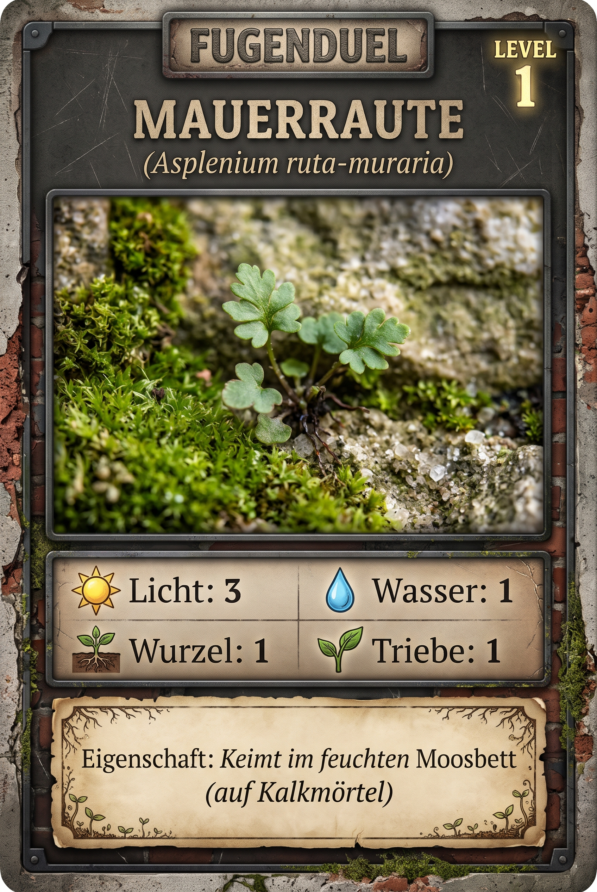

# Mauerraute (*Asplenium ruta-muraria*)

> **Familie:** Aspleniaceae (Streifelanfargewächse)  
> **Lebensform:** Hemicryptophyt (Immergrüner Fels- und Mauerfarn)  
> **Lebenszyklus:** Ausdauernd (Mehrjährig, langlebig bis 80-100 Jahre)  
> **Volksmund:** Mauerraute, Mauerstreifenfarn, Steinfarn, Mauer-Haarfarn, Wall-Rue Fern

---

## 📸 Bildübersicht & Spielkarten

### Fugenduel Spielkarte Level 1: Mauerraute



---

## 🌿 1. Echte botanische Daten (Wissenschaftliche Basis)

Diese Daten stammen aus empirischen botanischen Datenbanken (**Pladias**, **UNDERPLOT v39**) und bilden das unveränderliche wissenschaftliche Fundament dieser Pflanze.

### Standort-Zeigerwerte (Ellenberg / Pladias)
* ☀️ **Lichtzahl (L):** `8` / 9
* 💧 **Feuchtezahl (F):** `3` / 9
* 🧪 **Reaktionszahl / Kalk (R):** `8` / 9
* 🥩 **Stickstoffzahl (N):** `3` / 9
* 🧂 **Salzzahl (S):** `0` / 9

### Funktionelle Ökologie & C-S-R-Strategie (nach Grime / Pierce)
* **Strategietyp:** `S (Stress-Tolerator / Extremer Fels- & Kalkspezialist)`
* **C (Competitor - Konkurrenz):** `12.6 %`
* **S (Stress-Tolerator - Stresstoleranz):** `54.6 %`
* **R (Ruderal - Störungstoleranz):** `32.8 %`

### Morphologie & Wurzelmessungen (UNDERPLOT v39)
* **Wuchshöhe:** `0.05 – 0.2 m`
* **Wuchsform:** Dichte Horste mit ledrigen, rautenförmig geteilten blaugrünen Wedeln
* **Wurzelsystem:** Kurz kriechendes, dicht beschupptes Rhizom mit drahtigen Felswurzeln
* **Maximale Wurzeltiefe:** `k. A. m`
* **Maximaler Wurzelradius:** `k. A. m`
* **Knospenbank-Größe:** `10.0`

### Phänologie & Ausbreitung
* **Blütezeit:** Sporenreife Juli bis September (Farn bildet Sporen, keine Blüten oder Samen!)
* **Ausbreitungsmechanismus:** Anemochorie: Rund 10 Millionen mikroskopisch feine Sporen pro Pflanze und Jahr mit dem Wind

### Quellen
* [Pladias Database](https://pladias.cz/en/taxon/data/Asplenium%20ruta-muraria)
* [UNDERPLOT v39 (IDIV)](https://doi.org/10.25829/idiv.3610-56acy9)

---

## 🎁 2. Die Goodies: Kiez-Apotheke, Wildküche & Superkräfte

### 📜 Volksmund & Kulturgeschichte
> *Im Mittelalter hoch geschätztes Kraut der Klostermedizin. Wegen seiner rautenförmigen Blätter und seiner Unzerstörbarkeit auf sonnigen Burgmauern galt er als Symbol ewigen Lebens.*

### 💊 Kiez-Apotheke (Heilwirkung & Erste Hilfe)
* **Das historische Lungen- und Hustenkraut:** Wurde früher als schleimlösender Tee gegen hartnäckigen Husten, Keuchhusten und Bronchitis sowie bei Milz- und Gelbsuchtleiden getrunken.
* **Zubereitung & Anwendung:** Getrocknete Wedel als Aufguss (Tee). Heute wegen Naturschutz an Naturfelsen nur noch historisch bedeutsam.

### 🥗 Wildküche & Geschmack
* **Keine Speisepflanze:** Geschmacklich zäh, bitter und ungenießbar. Reine Heil-, Schutz- und Pionierpflanze.
* **Geschmack:** *Bitter, adstringierend, zäh*
* **Essbarkeit:** Nicht giftig, aber ungenießbar

### 🧪 Aktive biochemische Inhaltsstoffe
* **Gerbstoffe:** Stark adstringierend, gewebestraffend und antibakteriell.
* **Schleimstoffe:** Reizlindernd auf die Atemwege.
* **Flavonoide & Bitterstoffe:** Zellschützend vor UV-B-Strahlung auf sonnigen Mauerkronen.

### 💚 Optionaler Spiel-Heileffekt
* **Felsbalsam:** Schützt Nachbarpflanzen vor Pilzbefall.
* *Erzeugt durch basischen Kalkmörtel ein alkalisches Mikroklima, das schädliche Pilze hemmt.*

### 🔍 Draußen-Entdeckertipp für Kinder
> 💡 **Tipp für den Gehweg:** Such an alten Kirchen, Friedhofsmauern oder Brückenpfeilern nach Mauern mit weißem Kalkmörtel. Wenn du die Wedel im Hochsommer bei 35 Grad siehst, wirken sie oft braun und wie vertrocknet. Nach dem ersten Gewitterguss entfalten sie sich innerhalb weniger Stunden wieder saftig grün (Poikilohydrie)!

---

## 🎲 3. Spielwerte in den verschiedenen Spielsystemen

Jedes Spiel wählt aus den botanischen Merkmalen die passenden Spielwerte aus:

### A. Fugenduel Brettspiel (Taktile Kirchenmauer & Fugen-Netzwerk)
*Skala 1 bis 3 basierend auf den Pladias- und Traitwerten:*

| Stufe / Seite | Stufe | ☀️ Licht | 💧 Wasser | 🪴 Wurzelraum | 🌿 Triebe | Eigenschaft / Superkraft |
|---|---|:---:|:---:|:---:|:---:|---|
| **Seite A (Level 1)** | Jungfarn im feuchten Spalt | `3` | `1` | `1` | `1` | Jungfarn im feuchten Spalt |
| **Seite B (Level 2)** | Reife Wedel mit Sporenlagern | `3` | `1` | `1` | `2` | Reife Wedel mit Sporenlagern |

* **Netzwerk-Aktivität:**
  * 🪵 Wurzelstreifen: `Ja`
  * 🍄 Pilzstreifen (Mykorrhiza): `Ja`
  * 🐜 Ameisenstraße: `Nein`
  * *Hinweis:* Gedeiht besonders auf Kalkmörtel (pH > 7.5); benötigt Moos-Patches als feuchtes Keimbett für Sporen.

### B. Kartenspiel & Duell (0–10 RPG-Skala)
* **WURZEL:** `6` / 10
* **TRITT:** `2` / 10
* **DÜRRE:** `9` / 10
* **SAAT:** `4` / 10
* **TEMPO:** `2` / 10
* **CHEMIE:** `5` / 10
* **Gesamt-Budget:** `28` / 36

**Signatur-Fähigkeiten im Kartenspiel:**
* **Kalkanker** (Passiv | Bedingung: *Kalkfuge*): +3 WURZEL in historischem Mörtel
* **Austrocknungsstarre** (Ultimate | Bedingung: *Dürre-Runde verloren*): Erholt sich nach Dürre sofort; kein Deckungsverlust unter 5%

---

## 🎨 4. Bild-Prompts für Kartengenerierung (2:3 Format)

### Prompt Level 1 (Vorderseite)
```text
Create one finished FUGENDUEL botanical game card, portrait 2:3, full card visible with identical dimensions and layout across the series. Use a restrained weathered brick and dark stone frame, warm parchment panels, dark legible type, natural macro photography style and authentic urban plant anatomy.
Subject: Asplenium ruta-muraria. Stage: young vegetative plant or colony. Jungfarn im feuchten Spalt.
Render these German labels and values exactly:
FUGENDUEL
Mauerraute
Asplenium ruta-muraria
LEVEL 1
Spielwerte: Licht 3 | Wasser 1 | Wurzelraum 1 | Triebe 1
Eigenschaft: Jungfarn im feuchten Spalt
Footer: Artwerte, keine Messung dieser Pflanze. Level und Spielwerte sind Spielentwurf. k. A. = keine Angabe.
```

### Prompt Level 2 (Rückseite)
```text
Create one finished FUGENDUEL botanical game card, portrait 2:3, full card visible with identical dimensions and layout across the series. Use a restrained weathered brick and dark stone frame, warm parchment panels, dark legible type, natural macro photography style and authentic urban plant anatomy.
Subject: Asplenium ruta-muraria. Stage: established reproductive plant or colony. Reife Wedel mit Sporenlagern.
Render these German labels and values exactly:
FUGENDUEL
Mauerraute
Asplenium ruta-muraria
LEVEL 2
Spielwerte: Licht 3 | Wasser 1 | Wurzelraum 1 | Triebe 2
Eigenschaft: Reife Wedel mit Sporenlagern
Footer: Artwerte, keine Messung dieser Pflanze. Level und Spielwerte sind Spielentwurf. k. A. = keine Angabe.
```
