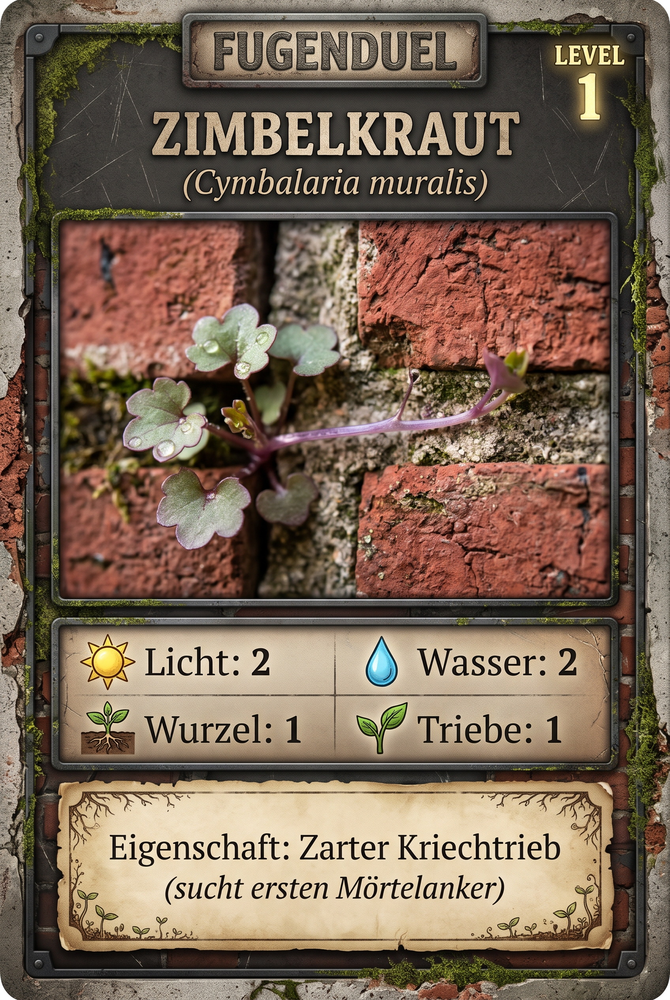
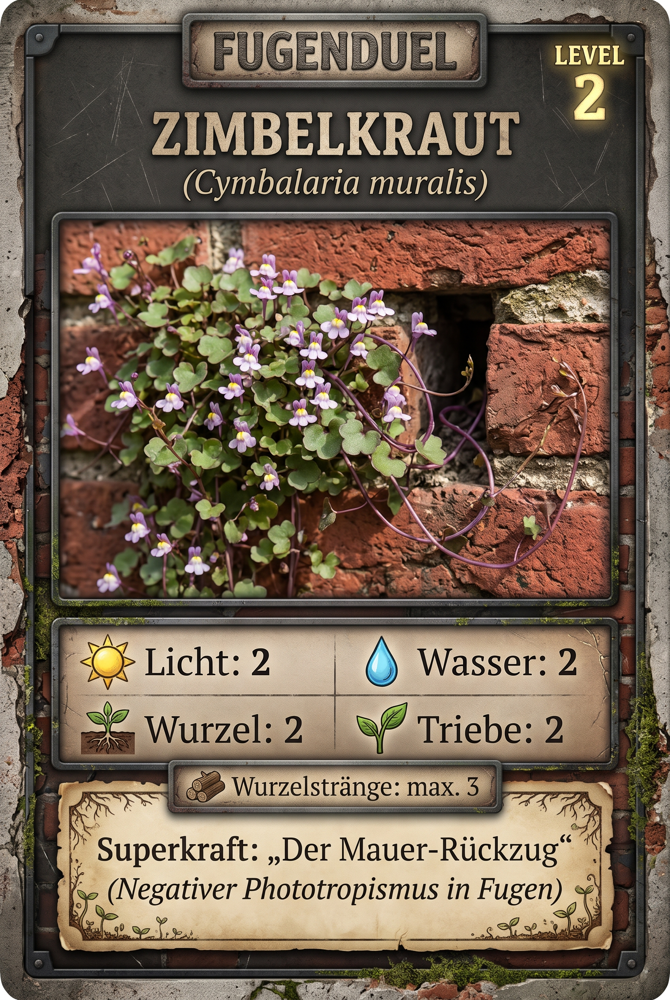

# Zimbelkraut (*Cymbalaria muralis*)

> **Familie:** Plantaginaceae (Wegerichgewächse)  
> **Lebensform:** Hemicryptophyt / Chamaephyt (Kriechtriebe an der Fugenwand)  
> **Lebenszyklus:** Ausdauernd (Mehrjährig)  
> **Volksmund:** Zimbelkraut, Mauer-Zimbelkraut, Mauerblümchen, Rittersporn der Armen, Ivy-Leaved Toadflax

---

## 📸 Bildübersicht & Spielkarten

### Fugenduel Spielkarte Level 1: Zimbelkraut



### Fugenduel Spielkarte Level 2: Zimbelkraut



---

## 🌿 1. Echte botanische Daten (Wissenschaftliche Basis)

Diese Daten stammen aus empirischen botanischen Datenbanken (**Pladias**, **UNDERPLOT v39**) und bilden das unveränderliche wissenschaftliche Fundament dieser Pflanze.

### Standort-Zeigerwerte (Ellenberg / Pladias)
* ☀️ **Lichtzahl (L):** `6` / 9
* 💧 **Feuchtezahl (F):** `4` / 9
* 🧪 **Reaktionszahl / Kalk (R):** `7` / 9
* 🥩 **Stickstoffzahl (N):** `5` / 9
* 🧂 **Salzzahl (S):** `0` / 9

### Funktionelle Ökologie & C-S-R-Strategie (nach Grime / Pierce)
* **Strategietyp:** `R / SR (Ruderal-Kletterer / Mauerfugen-Pionier)`
* **C (Competitor - Konkurrenz):** `37.3 %`
* **S (Stress-Tolerator - Stresstoleranz):** `0.0 %`
* **R (Ruderal - Störungstoleranz):** `62.7 %`

### Morphologie & Wurzelmessungen (UNDERPLOT v39)
* **Wuchshöhe:** `0.1 – 0.4 m`
* **Wuchsform:** Kriechend bis hängend, stielrunde rötliche Triebe mit efeuartig gelappten Blättern
* **Wurzelsystem:** Feine Adventivwurzeln an den Sprossknoten (Mörtelanker)
* **Maximale Wurzeltiefe:** `k. A. m`
* **Maximaler Wurzelradius:** `k. A. m`
* **Knospenbank-Größe:** `15.0`

### Phänologie & Ausbreitung
* **Blütezeit:** Mai bis September
* **Ausbreitungsmechanismus:** Autochorie / Aktiver Negativer Phototropismus: Nach der Bestäubung wenden sich Fruchtstiele vom Licht ab und schieben die Samenkapseln aktiv tief in dunkle Fugenritzen!

### Quellen
* [Pladias Database](https://pladias.cz/en/taxon/data/Cymbalaria%20muralis)
* [UNDERPLOT v39 (IDIV)](https://doi.org/10.25829/idiv.3610-56acy9)

---

## 🎁 2. Die Goodies: Kiez-Apotheke, Wildküche & Superkräfte

### 📜 Volksmund & Kulturgeschichte
> *Ursprünglich im Mittelmeerraum auf Kalkfelsen beheimatet, wurde im 16. Jahrhundert mit Marmorstatuen nach Mitteleuropa eingeschleppt und eroberte als 'König der Burgmauern' ganz Europa.*

### 💊 Kiez-Apotheke (Heilwirkung & Erste Hilfe)
* **Die historische Wundkompresse:** Früher zur Blutstillung bei Schnittwunden und als lindernde Auflage bei Hämorrhoiden und Hautentzündungen genutzt.
* **Zubereitung & Anwendung:** Frische Blätter zerdrücken und als Breiumschlag auf entzündete Hautpartien legen.

### 🥗 Wildküche & Geschmack
* **Mauer-Kresse auf dem Pausenbrot:** Junge Blätter und Blüten haben einen herrlich würzigen, pfeffrig-säuerlichen Geschmack, der stark an Kresse oder Brunnenkresse erinnert. Hervorragend auf Butterbrot, in Salaten oder Kräuterquark.
* **Geschmack:** *Pfeffrig, säuerlich, würzig wie Gartenkresse*
* **Essbarkeit:** Voll essbar (Blätter und Blüten roh)

### 🧪 Aktive biochemische Inhaltsstoffe
* **Vitamin C:** Hoher Ascorbinsäuregehalt, stärkt die Immunabwehr.
* **Flavonoide & Bitterstoffe:** Entzündungshemmend und adstringierend.
* **Glykoside:** Sanfte antimikrobielle Oberflächenwirkung.

### 💚 Optionaler Spiel-Heileffekt
* **Wundverschluss & Mörtelnaht:** Verschließt aufgebrochene Fugen gegen Kahlfrost.
* *Schützt angeschlossene Nischen vor Frostschäden durch dichten Geflechtsteppich.*

### 🔍 Draußen-Entdeckertipp für Kinder
> 💡 **Tipp für den Gehweg:** Such an alten Backstein- oder Sandsteinmauern! Schau dir verblühte Stängel genau an: Während die Blüten der Sonne entgegenstreben, krümmen sich die verblühten Fruchtstiele um 180 Grad zurück und bohren ihre Kapsel wie ein kleiner Bohrer in den finstersten Mauerspalt.

---

## 🎲 3. Spielwerte in den verschiedenen Spielsystemen

Jedes Spiel wählt aus den botanischen Merkmalen die passenden Spielwerte aus:

### A. Fugenduel Brettspiel (Taktile Kirchenmauer & Fugen-Netzwerk)
*Skala 1 bis 3 basierend auf den Pladias- und Traitwerten:*

| Stufe / Seite | Stufe | ☀️ Licht | 💧 Wasser | 🪴 Wurzelraum | 🌿 Triebe | Eigenschaft / Superkraft |
|---|---|:---:|:---:|:---:|:---:|---|
| **Seite A (Level 1)** | Zarter Kriechtrieb | `2` | `2` | `1` | `1` | Zarter Kriechtrieb (sucht ersten Mörtelanker) |
| **Seite B (Level 2)** | Etabliertes Polster mit Mauerrückzug | `2` | `2` | `2` | `2` | Samenkapseln in Mauerspalten |

* **Netzwerk-Aktivität:**
  * 🪵 Wurzelstreifen: `Ja`
  * 🍄 Pilzstreifen (Mykorrhiza): `Ja`
  * 🐜 Ameisenstraße: `Nein`
  * *Hinweis:* Hervorragender Trassenbauer: Kann im Spiel bis zu 3 Wurzel-/Kriechverbindungen legen!

### B. Kartenspiel & Duell (0–10 RPG-Skala)
* **WURZEL:** `4` / 10
* **TRITT:** `3` / 10
* **DÜRRE:** `6` / 10
* **SAAT:** `7` / 10
* **TEMPO:** `6` / 10
* **CHEMIE:** `4` / 10
* **Gesamt-Budget:** `30` / 36

**Signatur-Fähigkeiten im Kartenspiel:**
* **Mauer-Rückzug** (Aktiv | Bedingung: *Vertikale Wand*): Fruchtstiele schieben Samen direkt in geschützte Risse; immun gegen Straßenkehrer
* **Kriechspross** (Passiv | Bedingung: *Kalkfuge*): Erhöht Ausbreitungsreichweite um +1 Nische

---

## 🎨 4. Bild-Prompts für Kartengenerierung (2:3 Format)

### Prompt Level 1 (Vorderseite)
```text
Create one finished FUGENDUEL botanical game card, portrait 2:3, full card visible with identical dimensions and layout across the series. Use a restrained weathered brick and dark stone frame, warm parchment panels, dark legible type, natural macro photography style and authentic urban plant anatomy.
Subject: Cymbalaria muralis. Stage: young vegetative plant or colony. Zarter Kriechtrieb (sucht ersten Mörtelanker).
Render these German labels and values exactly:
FUGENDUEL
Zimbelkraut
Cymbalaria muralis
LEVEL 1
Spielwerte: Licht 2 | Wasser 2 | Wurzelraum 1 | Triebe 1
Eigenschaft: Zarter Kriechtrieb (sucht ersten Mörtelanker)
Footer: Artwerte, keine Messung dieser Pflanze. Level und Spielwerte sind Spielentwurf. k. A. = keine Angabe.
```

### Prompt Level 2 (Rückseite)
```text
Create one finished FUGENDUEL botanical game card, portrait 2:3, full card visible with identical dimensions and layout across the series. Use a restrained weathered brick and dark stone frame, warm parchment panels, dark legible type, natural macro photography style and authentic urban plant anatomy.
Subject: Cymbalaria muralis. Stage: established reproductive plant or colony. Samenkapseln in Mauerspalten.
Render these German labels and values exactly:
FUGENDUEL
Zimbelkraut
Cymbalaria muralis
LEVEL 2
Spielwerte: Licht 2 | Wasser 2 | Wurzelraum 2 | Triebe 2
Eigenschaft: Samenkapseln in Mauerspalten
Footer: Artwerte, keine Messung dieser Pflanze. Level und Spielwerte sind Spielentwurf. k. A. = keine Angabe.
```
